  <!-- Animated Header Wavy Banner -->
  

  <!-- Animated Typing SVG -->
  

    

  <!-- Social Badges -->
  

    
    
  

---

### 👨‍💻 Developer Terminal (`profile.py`)

  

---

## 🐍 Contribution Graph

  <picture>
    <source media="(prefers-color-scheme: dark)" srcset="https://raw.githubusercontent.com/anujawitharana/anujawitharana/output/github-contribution-grid-snake-dark.svg">
    <source media="(prefers-color-scheme: light)" srcset="https://raw.githubusercontent.com/anujawitharana/anujawitharana/output/github-contribution-grid-snake.svg">
    
  </picture>

---

## 🌟 About Me

Software Engineer & Computer Science Graduate from **Edith Cowan University (ECU)**. Specializing in high-performance backends, modern full-stack web applications with **Next.js & FastAPI**, relational databases, and scalable distributed architectures.

- 🎓 **Education**: Bachelor of Computer Science (Software Engineering), ECU — *Graduated*.
- ⚡ **Core Focus**: High-performance HTTP REST APIs, modern reactive frontends, and automated workflows.

---

## Tech Stack

  

---

  ## 🤝 Let's Connect

  
  

    

  <!-- Footer Wave Banner -->
  

  
© 2026 <b>Anuja Witharana</b>

